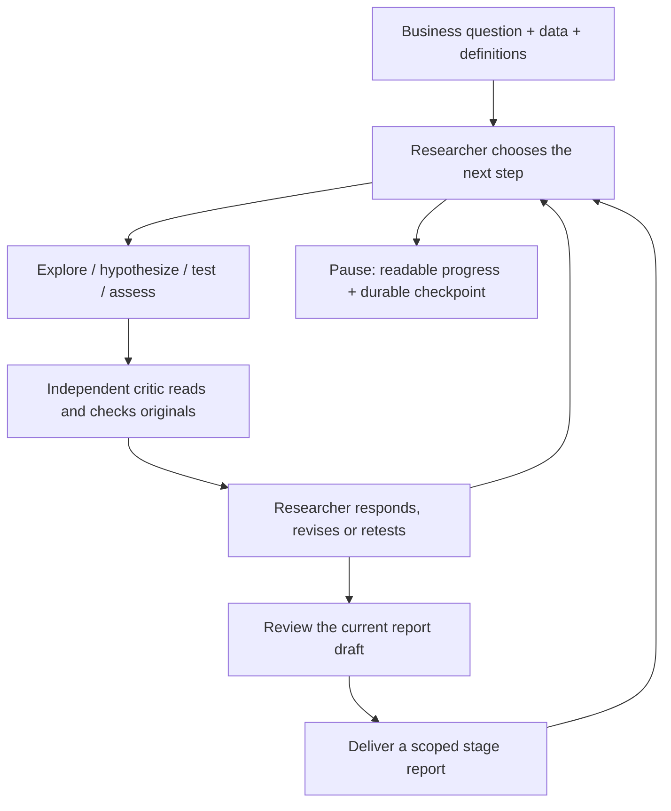

# Business Mechanism Research

**Persistent researcher–critic agents for evidence-led business research.**

[中文说明](README.zh-CN.md) · [System](docs/SYSTEM.md) · [Reproducibility](docs/REPRODUCIBILITY.md) · [Configuration / API](docs/CONFIGURATION.md) · [Operations](docs/OPERATIONS.md)

Give the system a business question, a SQLite database, and field definitions. A researcher chooses analyses, proposes falsifiable hypotheses, runs tests, and revises its understanding. An independent critic reads original records and performs its own checks. The researcher can revise, retest, rebut, or explicitly leave a question unresolved. Findings, counterevidence, revisions, and reports remain traceable.

The goal is a useful, scoped understanding of an operational or measurement mechanism. Algorithm improvement, baseline superiority, and positive results are not required.

**Status: research prototype, version 0.1.5.** Supported runtime families are macOS with `sandbox-exec` and Linux with `bubblewrap`, using Python 3.12. The CI matrix covers macOS arm64 and Ubuntu24.04 x86_64. The package provides a local CLI and synchronous Python API, not a hosted web service. Local engineering tests exercise two stages and recovery. Real-model report completion, day-long operation, and long-term research improvement remain unverified for this release. See [verified scope](docs/EVALUATION.md).

## How it works



LangGraph schedules the two roles and persists checkpoints. It does not impose a fixed sequence ending in algorithm design. A hypothesis can require multiple checks. Criticism is attributed feedback, not automatically a fact or a third-party scientific certification.

The current business-data adapter is **observational and read-only**. It supports SQL and sandboxed Python. New physical measurements or interventions require a separate adapter; repeated analysis of the same data is not independent validation.

## Install from source

Prerequisites: Python3.12, a working isolation backend and internet access for dependencies. macOS uses sandbox-exec. On Ubuntu24.04 install `bubblewrap` and `python3.12-venv` first with your package manager; see [Linux deployment](docs/LINUX.md) for namespace requirements. Native Windows execution is not supported.

```sh
git clone https://github.com/HoodieBush/business-mechanism-research.git
cd business-mechanism-research
python3.12 -m venv .venv
. .venv/bin/activate
python -m pip install -r requirements-tested.txt
python -m pip install --no-deps .
python -m pip check
business-research --help
python tools/check_install.py
```

If Python 3.12 has a different executable path, use it in the venv command. The lock file records tested dependency versions; the source package includes the required engine and does not need the original development repository.

## Verify without a model account

```sh
python scripts/check_release.py
python scripts/check_secrets.py --all-files
python tests/isolation.py --output ./acceptance-isolation
python tests/acceptance.py --output ./acceptance-local
```

Use a new output directory. Expect `acceptance-local/result.json` with `status: passed`, 17 true checks, and `external_provider_calls: 0`. A loopback HTTP fixture drives the actual graph, SQLite, sandbox, two roles, two stages, report archival, and pause/recovery. These tests do **not** call a model provider or prove scientific discovery quality.

## Configure a real study

1. Copy `model.example.json` to `model.json`. Replace the model and API-prefix placeholders with a compatible service you are authorized to use.
2. Store its key outside this repository and research workspaces, at the configured `api_key_file`, or use the declared environment variable. Do not put a key in JSON or command arguments.
3. Provide `business.sqlite`, `business_brief.md`, and `data_dictionary.json`. To learn the format, generate the public synthetic example:

```sh
python examples/create_example_data.py --output ./example-inputs
python tools/check_install.py --model-config ./model.json --data ./example-inputs
```

The example is a deployment demonstration, not company data or a blind scientific benchmark. The preflight makes no network request. The current model protocol expects native tool calls, `thinking`, `reasoning_effort: high`, and a 65,536 output limit; generic “OpenAI-compatible” service claims do not guarantee compatibility. See [configuration](docs/CONFIGURATION.md).

```sh
# Creates a workspace; no model request.
business-research create ./work/P001 \
  --question 'Investigate differences between registered and completed orders; distinguish supported findings from missing evidence.' \
  --model-config ./model.json --data ./example-inputs \
  --tokens 2000000 --requests 80 --wall-seconds 7200 --max-stages 2

# Calls the configured model provider and incurs its charges.
business-research run ./work/P001 --stages 1
```

The run blocks in the current terminal. In another activated terminal:

```sh
business-research status ./work/P001
business-research report ./work/P001
business-research pause ./work/P001
business-research run ./work/P001 --resume --stages 1
```

Pause is cooperative: an already-paid tool batch drains first. All roles and stages share the same finite capacity, request count, and persistent deadline. Restarting does not reset these limits. Two million tokens is an example allowance, not a promise of report completion. Exit codes are 0 for a completed command, 3 for pending, and 2 for errors.

## Outputs and reuse

```text
work/P001/
  deliveries/
    当前研究报告.md       current report, or explicitly unfinished progress
    阶段进展报告.md       hypotheses, assessments, criticism, responses, next steps
    阶段交接.md           execution and recovery handoff
    latest.json           versioned records and evidence index
    F*.md / F*.json       independently archived formal reports, when available
  researcher/             original scientific records and owned process archives
  reviews/                independent review snapshots and computations
  graph_checkpoints.sqlite
  graph_operations.sqlite
  common_budget.sqlite    shared execution limits; no external billing service required
```

Reports can be inconclusive. A progress export is not a reviewed scientific result. The next stage continues from the same evidence and memory after a current valid report; it cannot republish an old draft as new work. Back up the entire stopped workspace and resume with the same version and absolute path; general cross-version migration is not implemented.

## Code map and research scope

- `src/business_mechanism/`: public API, actual graph adapter, data interface, model transport, isolation, prompts and delivery.
- `src/business_mechanism/_engine/`: pinned source snapshot reused by the public layer. Historical module names preserve provenance; they are not additional supported entry points. See [source provenance](docs/SOURCE_PROVENANCE.md).
- `tests/acceptance.py`: executable local integration fixture, not model-generated scientific evidence.
- `examples/`: transparent synthetic input generator and data documentation.
- `docs/REPRODUCIBILITY.md`: exact engineering and optional real-model procedures, costs and evaluation boundaries.

There is no associated published paper or DOI yet. This release does not claim causal identification from aggregate observations, universal critic benefits, recursive self-improvement, or production availability. The repository provides an inspectable implementation and reproducible engineering path for further research.

## Contribute and cite

See [CONTRIBUTING.md](CONTRIBUTING.md), [SECURITY.md](SECURITY.md), and [CITATION.cff](CITATION.cff). Open an issue for deployment failures with the platform, software versions, command and a redacted error. Never post keys, raw private business data, or unredacted workspaces.

Licensed under [MIT](LICENSE); separately installed dependencies retain their own licenses. No model credential, proprietary business dataset, or historical paid experiment transcript is included.
